# PeliBox

**Lo que viste. Lo que vas a ver.**
PeliBox es una app web para llevar el registro de películas y series: qué viste, qué quieres ver, en qué episodio vas y dónde verlo en tu país. Los datos vienen de [TMDB](https://developer.themoviedb.org/) y tu lista se guarda en la nube con Firebase.

Sitio: [moviesconv2.netlify.app](https://moviesconv2.netlify.app/) · Creado por [Julio Conrado](https://github.com/conradojuliosisnero).

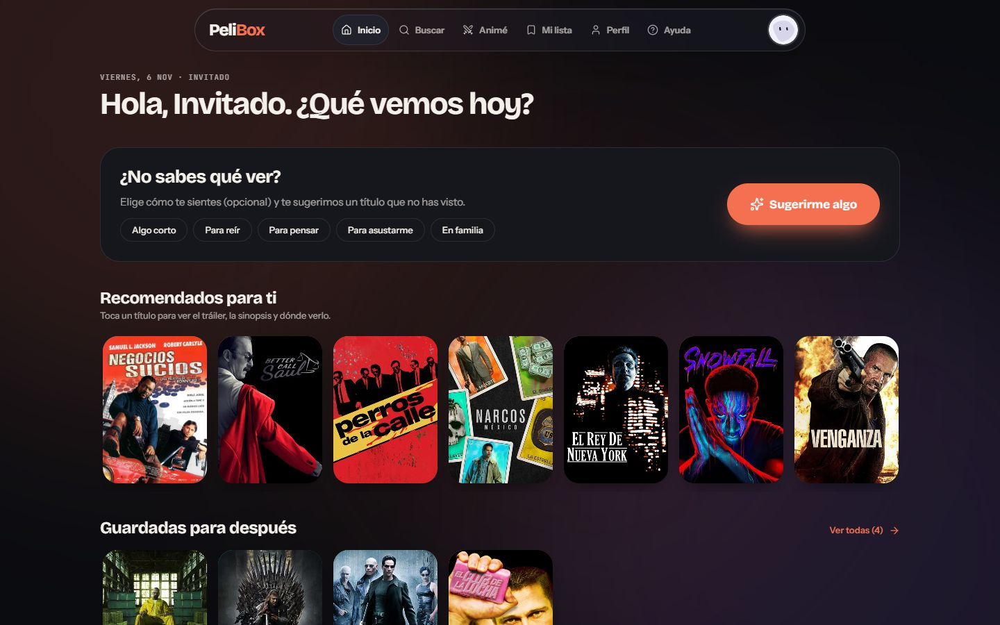

## Qué puedes hacer

| Pantalla | Qué hace |
| --- | --- |
| 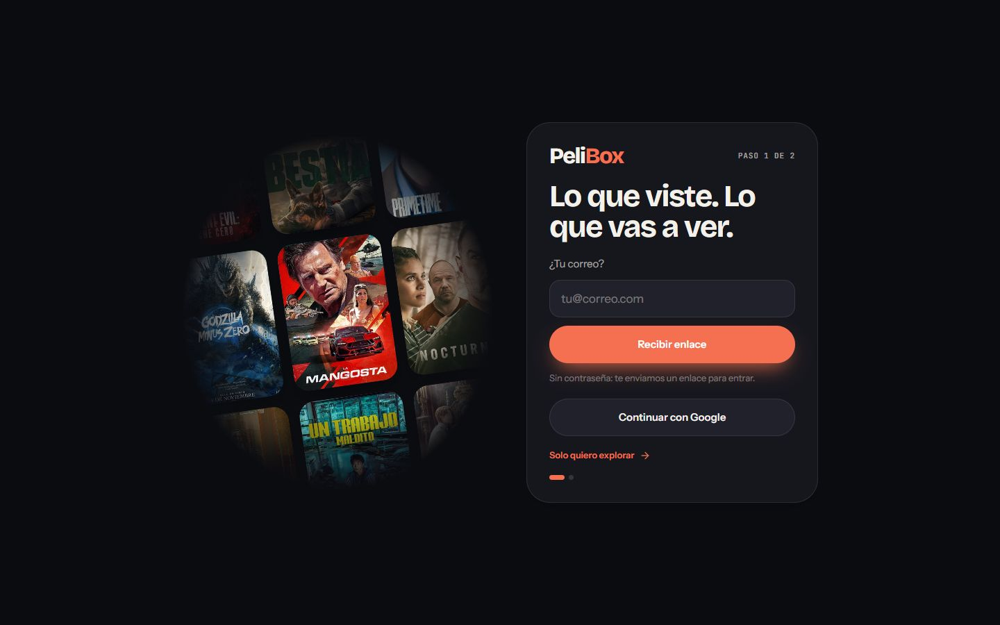 | **Entrar sin contraseña.** Con Google, con un enlace que llega a tu correo o en modo explorar (la lista queda solo en ese navegador). |
| 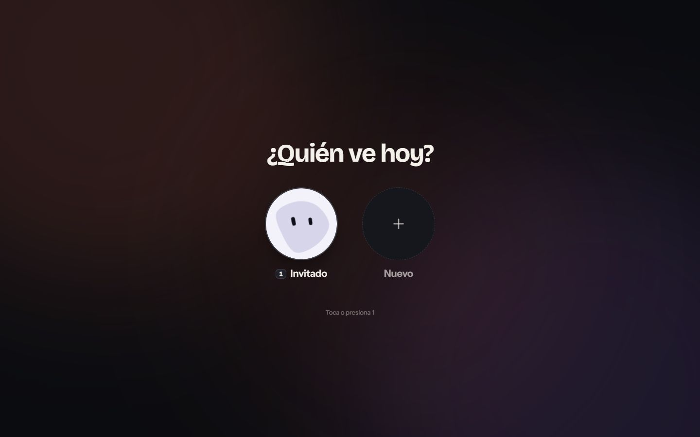 | **Perfiles por cuenta.** Cada uno con su avatar ([blobatar](https://blobatar.dev)) y su propia lista. El perfil infantil solo ve títulos familiares. Antes de elegir perfil hay una intro animada de la marca. |
| 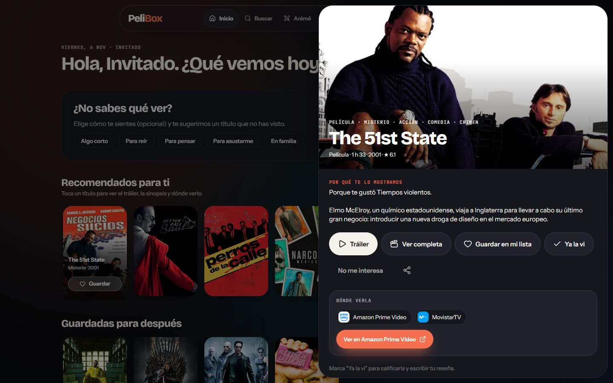 | **Ficha rápida.** Tráiler (en español si existe, si no en inglés), dónde verla en tu país, temporadas con episodios, reparto y similares. Se cierra arrastrando la cabecera. |
| 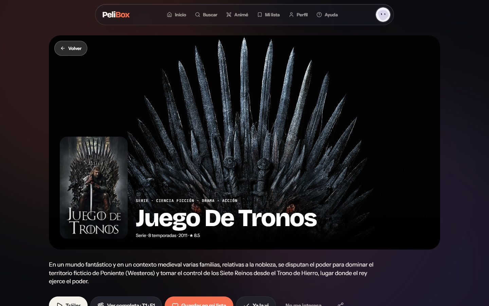 | **Página propia de cada título** (`/titulo/movie-550`), para compartir o verla a pantalla completa. |
| 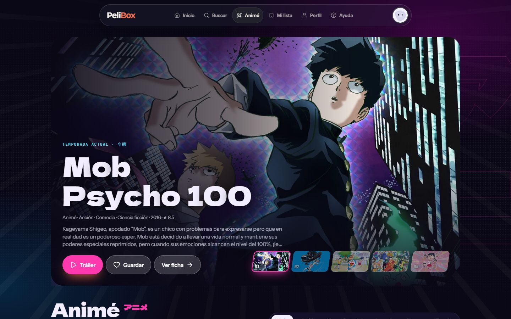 | **Sección de Animé** con su propia paleta, tipografía (Dela Gothic One), fondo de líneas de velocidad, intro con sonido y filtros por “vibra”. |
| 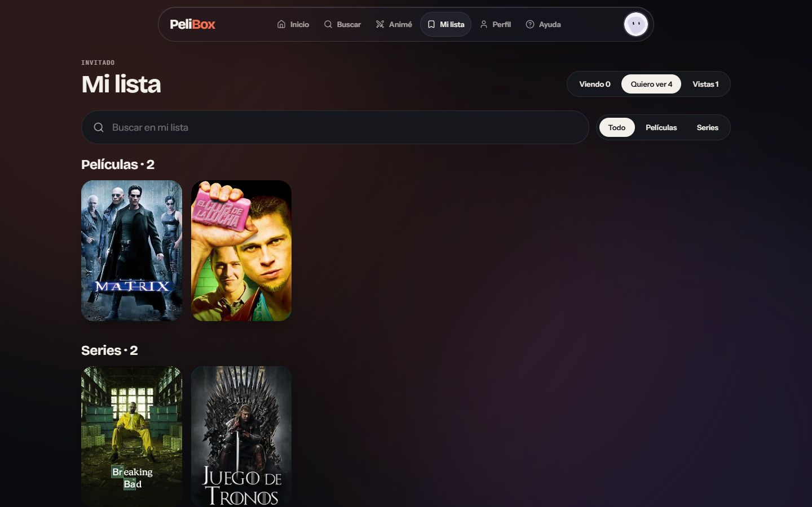 | **Mi lista.** Viendo, Quiero ver y Vistas, separadas en películas y series, con buscador, calificación y reseña. |
| 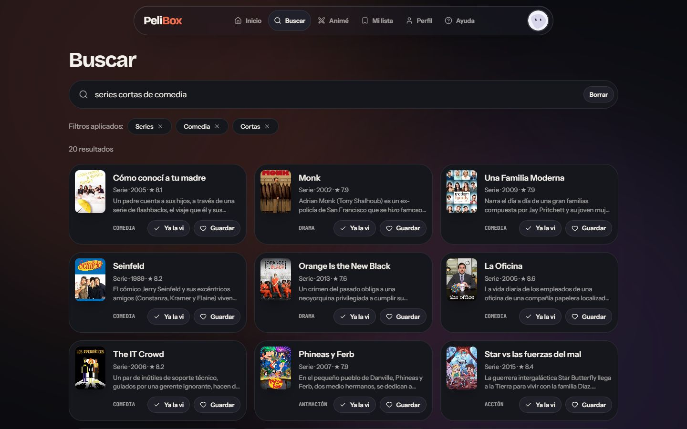 | **Búsqueda con filtros:** tipo, género, año o década, en cines, cortas, mejor valoradas y orden. También entiende lenguaje natural: “series cortas de comedia” se convierte en filtros que puedes quitar. Los filtros quedan en la URL. |
| 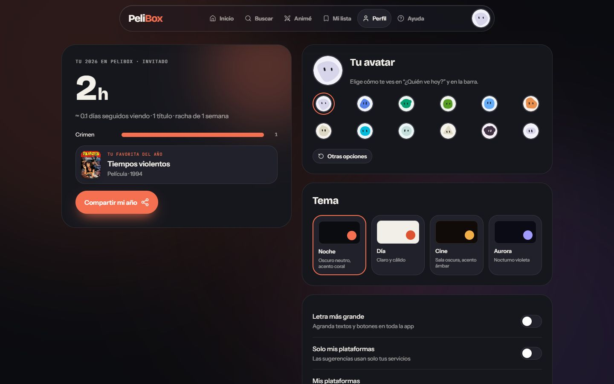 | **Tu año en números**, temas de color, letra grande y tus plataformas. |

También: **español e inglés** (menú del avatar o Perfil; TMDB responde en ese idioma), confeti al marcar algo como visto o terminar una serie, “Estoy viéndola” para series, “Sugerirme algo” según tu ánimo, recomendaciones con su motivo, tendencias, cartelera y próximos estrenos de Colombia, páginas de persona y de temporada, y novedades de la app.

### Correos

Plantilla de correo para recomendar un título, en versión PeliBox y versión Animé (`src/emails/titleEmail.mjs`).
`npm run email:test` envía tres correos de prueba (película, serie y animé): sin SMTP usa **Ethereal**, un buzón de prueba que no entrega a nadie y te da un enlace para verlos; con `SMTP_*` y `TEST_EMAIL_TO` en el `.env` los envía de verdad.

| Película (PeliBox) | Animé |
| --- | --- |
| 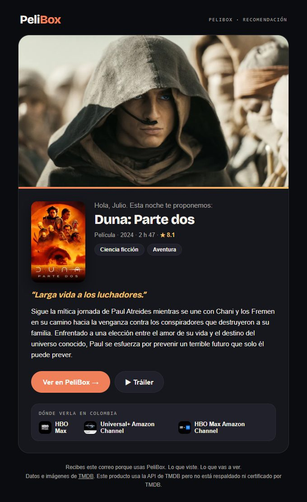 | 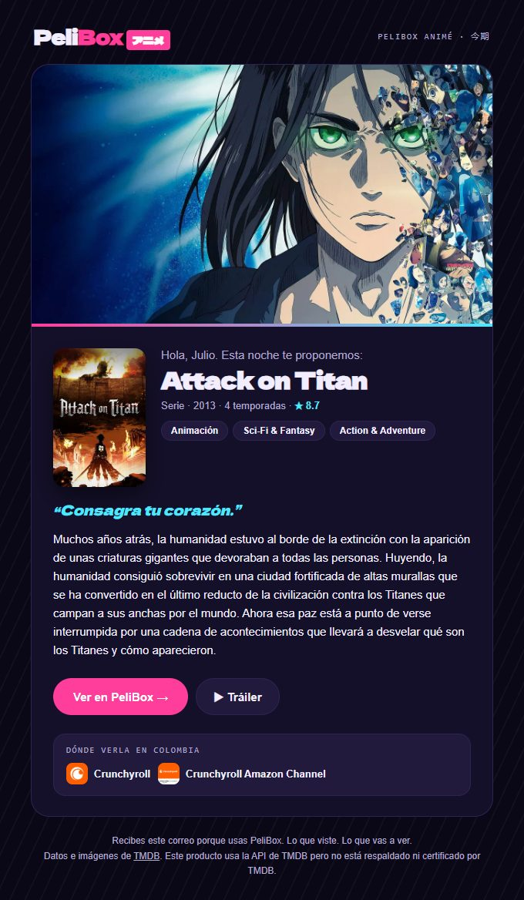 |

### Movimiento y gestos

Hecho con [GSAP](https://gsap.com): transiciones entre páginas, píldora deslizante en la barra y las pestañas, filas que se arrastran con impulso y cargan más títulos al llegar al final, tarjetas de la bienvenida que se lanzan, y un fondo que se mueve muy despacio con los colores del tema. Todo se apaga si el sistema pide “reducir movimiento”.

## Tecnología

- **Next.js 16** (App Router) + **React 19**, JavaScript y **CSS Modules**.
- **Firebase**: Authentication (Google y enlace por correo) y **Firestore** para la lista.
- **TMDB** a través de un proxy propio (`src/app/api/tmdb`): el token nunca llega al navegador, solo se permiten rutas de lectura y las respuestas se guardan en caché.
- **GSAP** (ScrollTrigger, Draggable, Inertia) para animaciones y gestos; **lucide-react** para íconos; **blobatar** para avatares.

## Empezar

```bash
npm install
cp env.example .env   # y llena los valores
npm run dev           # http://localhost:3000
npm run build         # producción
npm run check:i18n    # comprueba que español e inglés tengan las mismas claves
npm run email:test    # correos de prueba
```

### Variables de entorno

Ver `env.example`. Nunca subas el archivo `.env` al repositorio (ya está en `.gitignore`).

| Variable | Para qué |
| --- | --- |
| `BEARER_TOKEN` | Token de lectura de TMDB. Solo lo usa el servidor. |
| `NEXT_PUBLIC_FIREBASE_*` | Configuración web de Firebase (es pública por diseño). |
| `NEXT_PUBLIC_FULL_PLAYER_*` | Opcional: fuente de “Ver completa”. |
| `SMTP_*`, `TEST_EMAIL_TO` | Opcional: envío real de `npm run email:test`. |

### Configurar Firebase (una sola vez)

1. **Authentication › Sign-in method:** activa **Google** y **Correo electrónico** con **vínculo de correo (sin contraseña)**.
2. **Authentication › Settings › Authorized domains:** agrega `localhost` y tu dominio.
3. **Firestore Database:** créala y pega en **Reglas** el contenido de [`firestore.rules`](firestore.rules). Cada persona solo puede leer y escribir sus propios datos.

## Estructura

```text
src/
├── app/               rutas de Next.js (page.jsx delgados) + api/tmdb (único acceso a TMDB)
├── screens/           una pantalla por ruta (Home, Anime, Title, Library, Search, Person, Season…)
├── components/        ui/ (piezas base) · layout/ (barra, menú, Guard, fondo) · title/ (ficha, filas, tarjetas) · player/
├── services/          tmdb.js (cliente con caché) · catalog.js (formato de títulos, listas, búsqueda, estadísticas)
├── store/             Session (auth + perfiles), Library (Firestore), UI (ficha/reproductor), Toast
├── lib/               firebase.js · motion.js (GSAP) · sfx.js (sonidos con Web Audio)
├── hooks/  data/  config/  i18n/  icons/  theme/  utils/
firestore.rules        reglas de seguridad de Firestore
docs/screenshots/      imágenes de este README
```

## Reglas del diseño

- **Nada de valores sueltos:** colores, espacios, radios, tamaños y tiempos salen de `theme/tokens` como `var(--...)`.
- **Textos solo en `i18n/es.js` y `i18n/en.js`** (misma forma; `npm run check:i18n` lo verifica). **Íconos solo con `<Icon name="..." />`.**
- **TMDB solo desde `services/`.** **Animaciones solo con `lib/motion.js`**, siempre detrás de `motionOK()`.
- **Funciones a medias van detrás de `APP.features`** (por ejemplo “Ver juntos”, hoy apagada).

## Recetas

- **Nuevo tema:** agrega una clave en `theme/tokens/colors.js → palettes`.
- **Nueva pantalla:** `screens/Nueva/NuevaPage.jsx`, su ruta en `app/(app)/nueva/page.jsx` y en `config/app.config.js → ROUTES`.
- **Cambiar de país:** `APP.region` en `config/app.config.js` (plataformas, cartelera y estrenos).

---

Datos e imágenes: [TMDB](https://www.themoviedb.org/). Este producto usa la API de TMDB pero no está respaldado ni certificado por TMDB.
